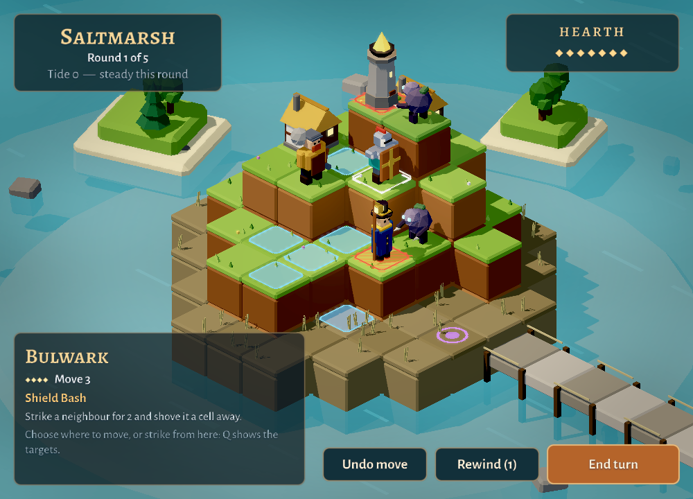
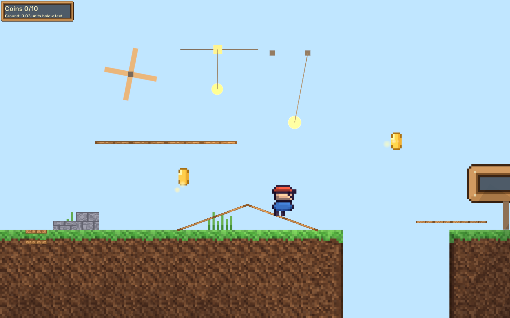
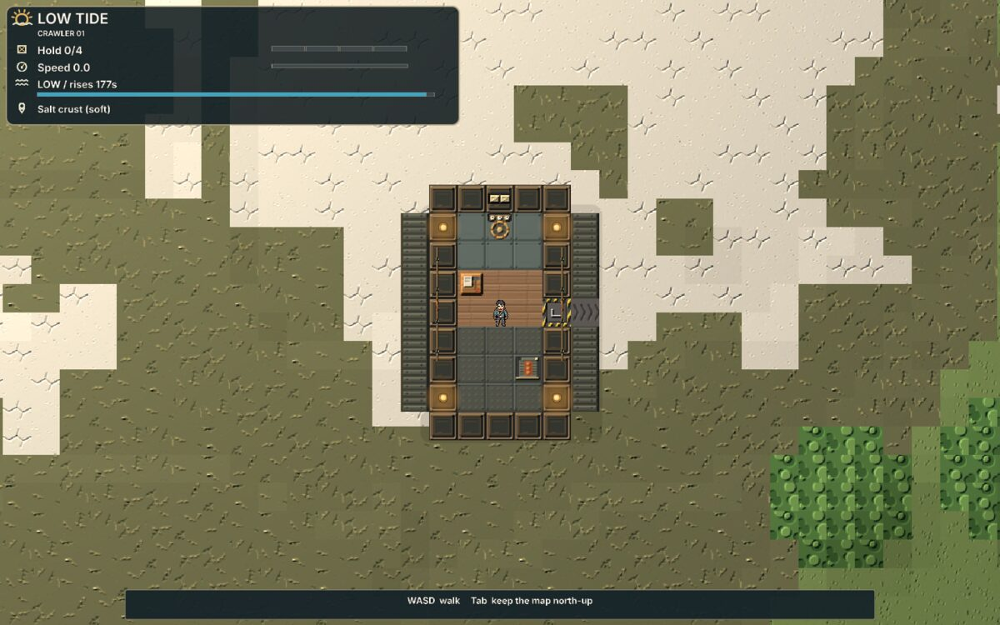
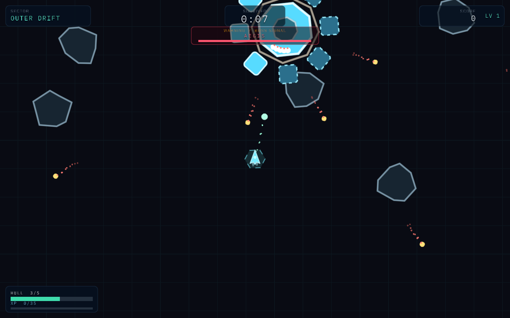
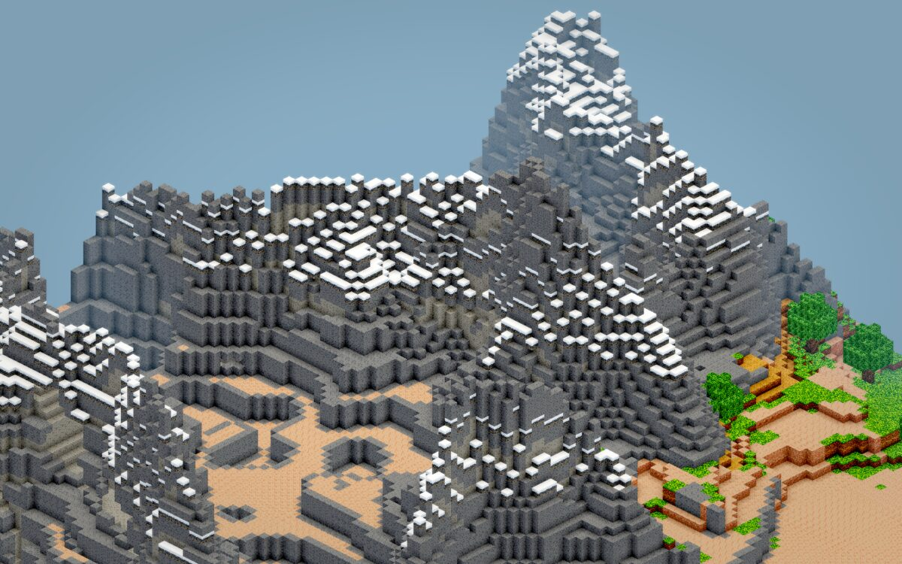
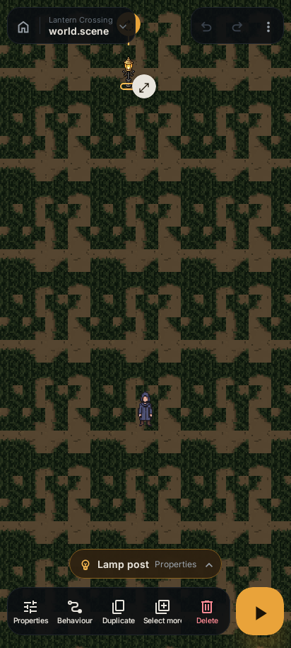
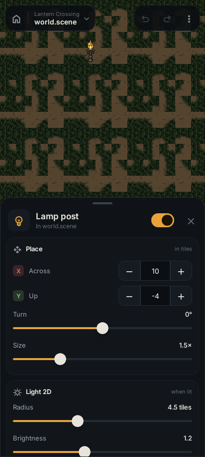
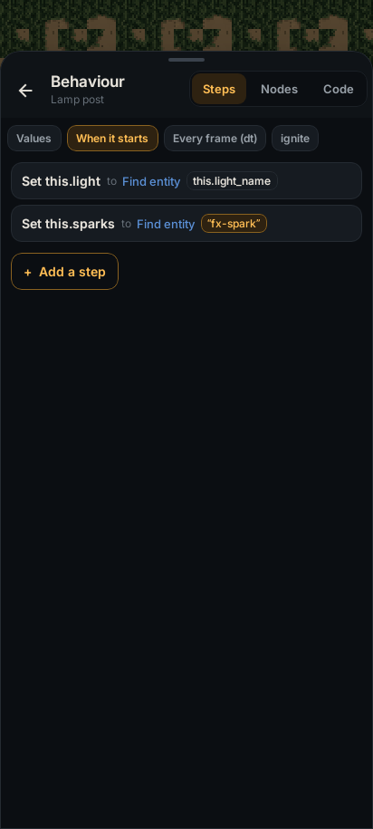

<p align="center">
  
</p>

<p align="center"><strong>A Rust-powered 2D + 3D game engine with a native visual editor, the Decay gameplay language, and responsive Weave UI.</strong></p>

<p align="center">
  <a href="#games-prove-the-engine">Games</a> ·
  <a href="#the-editor">Editor</a> ·
  <a href="#decay">Decay</a> ·
  <a href="#visual-decay-on-the-phone">Visual Decay</a> ·
  <a href="#weave">Weave</a> ·
  <a href="#try-it">Try it</a>
</p>

<p align="center">
  
  <br>
  <sub><strong>Causeway</strong>, the flagship: turn-based tactics on a lit low-poly diorama, built with Sindri's editor, Decay and Weave.</sub>
</p>

Sindri is a from-the-foundation rebuild of the original Sindri engine: **one runtime model, one scene format, one asset pipeline, and one renderer**, targeting native desktops, WebGPU browsers and, increasingly, phones. Games are authored through the editor, Decay and Weave. Rust is the language the engine is written in, not something you need for ordinary gameplay.

> **Status:** pre-alpha and under active development. Public APIs, Decay, Weave, editor workflows, and serialized formats may change while the engine is proven through real games.

## Games prove the engine

Nothing here counts as done because an API exists. A feature is finished when the editor can author it, Decay or Weave can drive it, and a real game uses it.

<table>
  <tr>
    <td width="50%"><br><sub><strong>Lamplighter</strong>: 2D lights and a darkness that pushes back, every lantern a Decay script.</sub></td>
    <td width="50%"><br><sub><strong>Low Tide</strong>: a crew walking a tilemap deck that drives and turns under them.</sub></td>
  </tr>
  <tr>
    <td width="50%"><br><sub><strong>Orbital Last Stand</strong>: the forcing function. A complete game rebuilt through the editor and Decay; every gap it exposes becomes an engine capability.</sub></td>
    <td width="50%"><br><sub><strong>Voxel Lab</strong>: generated, streamed and meshed voxel terrain.</sub></td>
  </tr>
</table>

- **Causeway** is the showcase: a game worth playing that pushes 3D rendering, model import, UI, scripting and audio.
- **Orbital Last Stand** is the forcing function described above.
- **Genre showcases** prove ordinary workflows: the platformer for plain 2D, **Scorchball** for local multiplayer, player-slot input, prefabs, animation and AI, and **Low Tide** for moving homes and tile reads and writes from Decay.
- **Feature examples and labs** isolate cameras, Weave, graphics and voxels where isolation is the honest way to test them.

Exact proof status for each capability lives in [`docs/parity.md`](docs/parity.md), with the evidence in [`docs/capabilities.md`](docs/capabilities.md). Every image in this README is produced by a capture tool in the repository, not a screen grab; see [`site/screenshots`](site/screenshots/README.md).

## The editor

<p align="center">
  
  <br>
  <sub>The native editor holding a whole game: Orbital Last Stand's 79-entity hierarchy, its asset tree, and the Scene and Game views.</sub>
</p>

The editor works on the **same world the runtime runs**: there is no mock copy to drift out of sync. It covers project browsing, hierarchy authoring, transforms and component editing, sprite-sheet slicing and animation preview, Decay `@export` fields, undo and redo, Scene and Game views, and Play, Pause and Stop against the real engine lifecycle, with console output and hot reload for assets and scripts.

## The authoring model

```text
                 Sindri Editor
                      |
              live World / Scene
               /             \
          Decay               Weave
        gameplay                UI
               \             /
                 Sindri Engine
                      |
                     Rust
```

- **Editor** authors the same world and scene representation the runtime uses.
- **Decay** is the statically typed gameplay language: state, behavior, events, input, physics, spawning, animation, audio, UI interaction and persistence live here, not in Rust gameplay code.
- **Weave** is the responsive presentation system: one authored interface adapts across viewport shapes.
- **Rust** implements the engine, renderer, platform layer, editor and language integration beneath them.

The goal: somebody can build and ship a Sindri game without understanding the Rust underneath.

## What Sindri is trying to be

- **2D and 3D in one engine**, without forcing ordinary 2D work through 3D abstractions.
- **A real native visual editor**, not a separate mock of the runtime.
- **A purpose-built gameplay language**: Rust-inspired, statically typed, project-aware, and made for games rather than systems programming.
- **Native and web from the same foundation**: Rust, `wgpu`, `winit`, WebGPU and WASM.
- **Portable, review-friendly projects**: canonical scene files, logical asset IDs, reusable prefabs and profiles, no hidden sidecar identity.
- **Actionable diagnostics**: changed-scope preflight, structured CI diagnostics, project-aware Decay checking.

Sindri is not trying to win a feature-count contest with mature engines. The goal is a coherent engine that is pleasant to build games with and difficult to accidentally lie about.

## Decay

Decay is Sindri's Rust-inspired, statically typed gameplay language. The language implementation lives in its own workspace and is engine-agnostic; `sindri-decay` is the one-way binding layer that exposes Sindri's world and host APIs.

```rust
script Player {
    @export
    var speed: number = 6.0;

    fn update(dt: number) {
        let movement = Input.axis("ArrowLeft", "ArrowRight");
        this.transform.position.x += movement * speed * dt;
    }
}
```

Decay now goes well beyond isolated callbacks and stringly host calls. Current language and Sindri integration include:

- typed editor-visible `@export` fields;
- `Vec2` and `Vec3` values and vector operations;
- typed script references, so scripts can find and communicate with other script types without property-name strings;
- typed script messages;
- project-wide typed events with `event`, `emit`, and `on`;
- typed shared project state;
- arrays, maps, bounded loops, entity/prefab/profile references, and operation budgets;
- transforms, sprites, animation, input, physics/collisions, spawning, UI, audio, effects, persistence, grids, and other checked host APIs;
- project-aware checking through `decay-lsp`, including structured diagnostics and completion work that is evolving alongside the language.

A misspelled host member, wrong event payload, invalid script relationship, or incompatible type should be caught as a Decay diagnostic rather than becoming a mysterious runtime fallback.

Decay intentionally does **not** inherit Rust's ownership, borrowing, lifetimes, `unsafe`, or systems-programming machinery. Rust inspires the syntax, static typing, and tooling quality; Decay remains focused on gameplay.

See [`decay/LANGUAGE.md`](decay/LANGUAGE.md), [`docs/scripting.md`](docs/scripting.md), and [`docs/decay-direction.md`](docs/decay-direction.md).

## Visual Decay on the phone

<table>
  <tr>
    <td width="33%"></td>
    <td width="33%"></td>
    <td width="33%"></td>
  </tr>
</table>

The Android editor, in progress, runs the same engine as the desktop editor: select, inspect, edit and play a scene on the phone. Scripts open as **steps**: each line of Decay a sentence with its values as tappable chips, branches indented beneath, and the same script one tap away as Blueprint-style nodes. There is no graph format behind either. **Visual scripting is Decay, but visual:** the `.decay` file is the only thing stored. The handler on the right above is just this:

```rust
fn start() {
    this.light = World.find(this.light_name);
    this.sparks = World.find("fx-spark");
}
```

Write a script by hand on desktop, open it as nodes on the phone, change it there, and it reads on desktop exactly as if it had been typed. Every node edit is a splice of the script's text, re-parsed and type-checked before it is kept, with comments and formatting left alone. On the phone nodes run top to bottom like code; on desktop, left to right. See [`mobile/README.md`](mobile/README.md#visual-decay).

## Weave

Weave is Sindri's responsive UI/presentation system. It exists so game interfaces do not have to become piles of viewport-specific coordinates or gameplay code manually rearranging rectangles.

Weave presentation rules resolve into ordinary Sindri UI data, allowing one authored interface to recompose for different viewport shapes while remaining part of the same scene/runtime model. The system is developed alongside Decay and the editor rather than as a separate UI stack bolted on afterward.

The responsive showcase and current language/limitations are documented in [`docs/weave.md`](docs/weave.md).

## What works today

Sindri is pre-alpha, but the working surface is already broad. Highlights include:

### Engine and runtime

- deterministic lifecycle and fixed-step simulation;
- generation-checked entities, hierarchies, and composed 2D/3D transforms;
- canonical, versioned scene serialization and reversible world commands;
- keyboard, pointer, touch, and local gamepad/player-slot input;
- logical asset IDs, asynchronous loading, manifests, and hot reload;
- native-windowed, headless, and WebGPU browser hosts;
- textured/layered sprites, sprite sheets and animation;
- 3D meshes, perspective/orthographic cameras, lighting and bounded directional shadows;
- external static GLB model assets with retained hierarchy, material factors/textures,
  reusable GPU geometry, material-aware directional shadow casting/reception and
  native/browser project delivery (full imported-model editor UX remains deferred);
- shared numeric standard material factors and opt-in GGX shading, authored with
  checked color, metallic/roughness and emission controls; see
  [`docs/rendering-materials.md`](docs/rendering-materials.md);
- tilemaps, grids, occupancy, walls, placement validation, and pathfinding;
- voxel world storage, generation/streaming, meshing, and editor/runtime rendering work;
- Rapier2D physics with authored bodies/colliders, sensors, masks, events, velocity, and impulses;
- native/browser audio;
- prefabs and reusable profile data;
- responsive Weave presentation;
- static web export;
- deterministic rendering/capture paths exercised in CI.

This summary is intentionally not exhaustive. [`docs/capabilities.md`](docs/capabilities.md) is the evidence-based inventory; [`docs/parity.md`](docs/parity.md) records Engine / Editor / Decay / proof status and the important gaps against a conventional game-engine baseline.

## Architecture

Sindri keeps engine concerns in focused Rust crates while Decay remains its own workspace.

```text
                         Sindri Editor
                              |
                       live World / Scene
                      /       |        \
                 Assets    Rendering   Decay host
                    |          |           |
              sindri-assets  sindri-render  sindri-decay
                               |           |
                           sindri-gpu   decay-runtime
                               |           |
                              wgpu      decay-ir
                               |           |
                       Native / Web    decay-semantic
                                           |
                                      decay-syntax
```

The important boundary is intentional:

```text
decay/*                 knows the language, not Sindri
crates/sindri-decay     knows both halves
sindri engine crates    do not depend on Decay
```

That keeps the language embeddable and prevents Sindri implementation details from leaking into Decay core. The renderer-independent engine core likewise has no dependency on a window, GPU, browser, editor, physics engine, scripting runtime, or async executor.

## Native and web

The web is a first-class runtime target rather than a separate edition. Native and browser hosts share the same engine concepts, scene extraction, assets, GPU abstraction, renderer, Decay gameplay model, and Weave presentation policy.

Static WebAssembly/WebGPU exports are exercised through repository projects and browser smoke tests. A browser needs WebGPU support.

## Important gaps

Sindri is still pre-alpha. Among the meaningful gaps and incomplete areas are:

- richer asset import, preview, and project-settings workflows;
- deeper prefab authoring/linked-instance workflows;
- polished external Decay authoring, formatting, debugging, and the remaining language-server/IDE features;
- richer Weave editor tooling and accessibility work;
- native packaging/release tooling beyond the current web exporter;
- a mature 3D content pipeline, including broader materials/import formats, skeletal animation, and more complete lighting/physics features;
- the accumulated stability, documentation, platform coverage, and real-world usage expected of a mature engine.

For the current outside-in audit rather than an aspirational feature list, see [`docs/parity.md`](docs/parity.md).

## Try it

The workspace currently requires Rust 1.95.

```bash
cargo editor                      # the welcome window, optimized
cargo editor games/platformer     # straight into a project
```

`cargo editor` is an alias for an optimized, incrementally built profile: the
editor plays a game about as fast as a release build does. Working on the
editor itself, `cargo run --package sindri-editor` builds faster after an
edit and still optimizes every dependency.

The repository includes games, feature examples, fixtures, deterministic captures, and regression tests that exercise the same implementations used by the editor and runtime.

## Development

Engine/editor workspace:

```bash
cargo fmt --all --check
cargo clippy --workspace --all-targets --all-features
cargo test --workspace --all-features
cargo check --workspace --all-features --target wasm32-unknown-unknown
```

Decay is intentionally a separate Cargo workspace:

```bash
cd decay
cargo fmt --all --check
cargo clippy --workspace --all-targets -- -D warnings
cargo test --workspace
```

For changed Decay scripts, use the typed project-aware preflight rather than treating syntax alone as proof:

```bash
cargo run --quiet --package decay-lsp -- --check path/to/script-or-project
```

Repository guidance and the complete required checks live in [`AGENTS.md`](AGENTS.md).

## Documentation

Start here:

- [`docs/parity.md`](docs/parity.md) — outside-in Engine / Editor / Decay / proof audit and important gaps
- [`docs/capabilities.md`](docs/capabilities.md) — detailed evidence for what demonstrably works
- [`decay/LANGUAGE.md`](decay/LANGUAGE.md) — Decay language reference
- [`docs/scripting.md`](docs/scripting.md) — Decay-to-Sindri host surface
- [`docs/decay-direction.md`](docs/decay-direction.md) — why Decay exists and how its authoring model evolved
- [`docs/weave.md`](docs/weave.md) — responsive UI/presentation model
- [`docs/project-format.md`](docs/project-format.md) — project structure and `sindri.toml`
- [`docs/diagnostics.md`](docs/diagnostics.md) — diagnostics and CI/preflight model
- [`ROADMAP.md`](ROADMAP.md) — development plan
- [`AGENTS.md`](AGENTS.md) — architecture, contribution, proof, and verification rules for coding agents

Subsystem contracts live under `docs/` beside the code they describe.

## Why Sindri?

Sindri's central bet is that a Rust engine does not have to make Rust the everyday game-authoring experience.

The editor owns the world. Decay owns gameplay. Weave owns responsive presentation. Rust provides the engine underneath. Those surfaces are developed together and proved through actual games rather than treated as independent checkboxes.

The project has a simple rule: **working code beats plausible architecture**. A capability is not complete because an API exists or an editor control is visible; it is complete when the relevant authoring surface can use it and a real project proves it.

## Contributing

Read [`CONTRIBUTING.md`](CONTRIBUTING.md) for checks, conventions, and commit style, and [`CODE_OF_CONDUCT.md`](CODE_OF_CONDUCT.md) for participation guidelines. The dependency policy is documented in [`docs/dependency-policy.md`](docs/dependency-policy.md).

## Support Sindri

Sindri is an independent, open-source game engine developed in my spare time. If you'd like to support its continued development, you can [buy me a coffee](https://buymeacoffee.com/madsendev).

Contributions, feedback, and GitHub stars are also appreciated.

## License

Dual-licensed under either the [Apache License 2.0](LICENSE-APACHE) or the [MIT license](LICENSE-MIT), at your option.

Unless you state otherwise, any contribution intentionally submitted for inclusion in Sindri is dual-licensed as above, with no additional terms or conditions.
